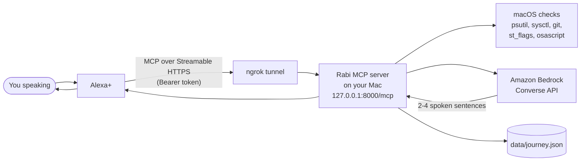

# Rabi

**A voice companion for developers, through Alexa+.** Rabi figures out why your Mac is struggling and talks you through fixing it, and after a tough hackathon result it reminds you of your real record and points you at what's next.

> "Alexa, ask Rabi why my Mac is slow."
> "Xcode is using most of your memory and an iOS Simulator is running in the background. Want me to close the Simulator?"

Rabi is a self-hosted **MCP server** (Model Context Protocol, spec **2025-11-25** over **Streamable HTTP**) that runs on your Mac. Alexa+ calls its tools; Rabi runs read-only macOS checks and uses **Amazon Bedrock** to turn the raw numbers into a couple of friendly spoken sentences.

Built for the Amazon "Build, Ship, Shape" Developer Hackathon (Alexa+ track).

## Why

iCloud "Optimize Mac Storage" quietly offloaded the files in one of my Python virtual environments. `import torch` took **24 minutes** while macOS downloaded placeholders one by one. Nothing told me why. Rabi's `icloud_stuck_projects` tool exists so nobody else loses an evening to that.

## Architecture

## Tools

| Tool | What it does | Changes anything? |
|---|---|---|
| `ping` | Health check: `{status, server, time}` | No |
| `system_health` | CPU %, load vs cores, memory used, **memory pressure** (normal/warning/critical), swap | No |
| `heavy_apps` | Top apps by memory and CPU, helper processes grouped under their `.app` (all Chrome helpers count as Chrome) | No |
| `disk_space` | Free/used space on the main disk, low-space flag under 10 GB | No |
| `icloud_stuck_projects` | Finds code projects in `~/Desktop` and `~/Documents` (folders with `.git`, `pyproject.toml`, `requirements.txt` or `package.json`), samples up to 200 files each, and checks the `SF_DATALESS` flag to report the % offloaded to iCloud | No |
| `unpushed_work` | Git repos under `~/dev` (or `RABI_PROJECT_ROOTS`) with uncommitted changes or commits ahead of upstream. Never fetches | No |
| `why_is_my_mac_slow` | Runs health + heavy apps + disk, then explains via Bedrock in 2-4 spoken sentences | No |
| `explain_check` | Runs one named check and explains it aloud | No |
| `my_journey` | Encouragement after a loss, grounded only in `data/journey.json`, plus your next deadline | No |
| `close_app` | Quits an app like Cmd+Q, **only after a confirmation round trip** (see below) | Yes |

### `close_app` confirmation flow

1. `close_app(app_name="Simulator")` → returns what will be closed and a `confirm_token`. Nothing happens yet.
2. `close_app(app_name="Simulator", confirm_token="...")` → runs `osascript -e 'quit app "Simulator"'`.

Tokens are single-use, bound to that app, and expire after 60 seconds. Apps can still ask you to save; Rabi never force-kills. Finder, Dock, WindowServer, loginwindow, SystemUIServer, kernel_task, launchd, Terminal, Python and similar are refused.
